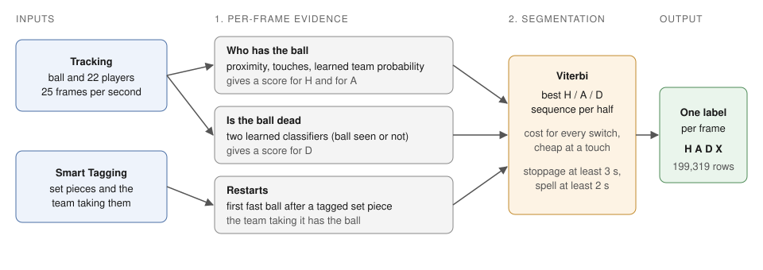

# Ball possession from automatic tracking: technical document

November 2026

## 1. Approach

For every frame of BAR-ATH we decide one of three states: Barça has the ball (H), Athletic has the
ball (A), or the ball is dead (D). The ranking metric, spellF1, scores whole possessions rather than
frames, so a model that is right on most frames but flickers between teams scores badly. The model
therefore has two layers.



1. **Per-frame evidence.** For each frame, a score for each of H, A and D, computed from the
   tracking and the Smart Tagging.
2. **Segmentation.** A Viterbi pass picks the most likely H/A/D sequence for each half, with a cost
   for every switch between states. The output is a small number of whole possessions and
   stoppages.

Every source of information plugs into one of these two layers. All tunable values sit in one table
(`PARAMS` in `possession/model.py`).

We chose this over a learned frame-by-frame classifier for who has the ball because possessions
have to be segmented, not just classified, and the segmentation lets football rules (a stoppage
lasts at least 3 seconds, a change of possession needs control) be stated directly as costs and
constraints. Two things are learned and enter as evidence: the dead-ball probability and a team
probability (2.1), both trained on external matches only.

## 2. Per-frame evidence

### 2.1 Who has the ball in live play

- **Proximity.** The team whose nearest player is closer to the ball gets more evidence, through a
  soft comparison of the two distances (scale 1.5 m). Beyond 4 m nobody is treated as close. While
  the ball travels faster than 11 m/s it is in flight and proximity is ignored.
- **Touches.** A touch is a sudden change in the ball's velocity: a turn of at least 10 degrees or a
  speed change of at least 5 m/s, with a velocity jump above 1.5 m/s. This follows Vidal-Codina et
  al. (2022), where a ball near a player with no change of flight is not a touch. The player who made
  it is the nearest one within 2.5 m at that moment or in the 3 frames before (the ball track is
  smoothed, so a touch registers slightly late). A touch is evidence for its team for the next
  10 seconds.
- **Switch costs.** Changing team costs 60 in the segmentation, but only 10 at a touch by the team
  taking over. Possession therefore changes hands at a touch, not when the ball merely drifts closer
  to an opponent.
- **Learned team probability.** A gradient-boosted classifier gives the probability that Barça has
  the ball in each frame where the ball is seen, from tracking only: distances and speeds of each
  team's nearest players, time since each team's last touch, the touch owner, player density around
  the ball, the nearest players' movement relative to the ball, the relative distance advantage, the
  ball's path over the last 0.4 s (turned to the attacking direction of each half) and rolling means
  of who was nearer over the last 1 and 3 s. Rolling and path features look back only. It is trained
  on Metrica matches 1 and 2 and the seven DFL open matches (every 5th live frame with the ball seen,
  tracks degraded as on the bench, labels with the 1.5 s control rule), never on match 3 or on
  BAR-ATH. It is added to the hand-set evidence at weight 0.25, so it shifts the evidence but the
  switch costs still decide when possession changes (`possession/team_evidence.py`).

### 2.2 Dead ball

- **Learned dead-ball probability.** Two gradient-boosted classifiers give the probability that the
  ball is dead in each frame. One uses ball signals (speed, standing still, outside the lines,
  distance to the nearest line and to the nearest player) together with player signals. The other
  uses player signals only (mean speed, slowing down or speeding up, number tracked) and is used
  where the ball is not seen. They are trained on Metrica matches 1 and 2 only, each used in several
  copies under random degradations (a missing-ball share from 0 to 50%, and ball smoothing, drift and
  noise over wide ranges), so no value in the training data is taken from the match being labelled.
- **Where the ball is missing.** On BAR-ATH the ball is missing on about 41% of the graded frames.
  These gaps are almost never short (none between 1 and 5 seconds) and players move in them as they
  do in stoppages, so a missing ball is strong evidence for dead ball.
- **The ball carried to the spot.** A live spell between two stoppages, shorter than 10 seconds, in
  which the ball never moves faster than 5 m/s is part of the stoppage: there was no kick or pass, so
  play never restarted.
- **Minimum stoppage.** A stoppage lasts at least 3 seconds (97% of stoppages in the validation
  matches do).
- **Forced intervals.** The ball is dead before each half's kick-off and live for the first second
  after it. It is also dead whenever fewer than half of the 22 players are on the tracked pitch for
  10 seconds (the walk-off at the final whistle and the trip to the bench in a hydration break).

### 2.3 Restarts

- Smart Tagging marks free kicks, corners, goal kicks and kick-offs with the team taking them. The
  restart itself is found as the first moment after the tag where the ball goes from still to moving
  faster than 6 m/s, and the team taking it gets the ball for the first moment of play.
- Throw-ins are tagged without a team. For those, the team is that of the player holding the ball at
  the touchline just before it is thrown (right 94 to 100% of the time on the validation matches;
  the last touch before the ball went out was no better than a coin flip).

## 3. Possession rules and where they are implemented

| Rule | Implementation |
|---|---|
| **Loose and contested balls** stay with the last team that had the ball. A challenge, a tackle that knocks the ball loose, a deflection or an aerial duel does not change possession on its own. | Switch costs (2.1): a change needs a touch by the new team, and without one the cost of 60 keeps the old team. |
| **A change of possession needs control.** The new team must touch the ball and keep it for at least 2 seconds, or the spell goes back to the team that had it before. A short spell straight after a stoppage is kept, because play always restarts with a clear possessor. | Minimum spell of 50 frames after the segmentation. |
| **Dead ball** runs from the moment play stops until a player restarts it (free kick, throw-in, goal kick, corner, kick-off, drop ball). Nobody gains or loses possession in between, whoever carries the ball to the spot. | Dead-ball probability, minimum stoppage and the rule for the ball carried to the spot (2.2). |
| **Restarts** belong to the team taking the set piece. After a drop ball the team that had the ball keeps it. | Smart Tagging restarts (2.3). |
| **Advantage** is play on: when the referee signals advantage the ball stays live. If he blows later, the stoppage starts at the whistle, not at the original foul. | Follows from the dead-ball probability, which reacts when the players stop. |

## 4. Data used and alternatives tested

| Data | Use |
|---|---|
| Tactical tracking (ATD) | ball and player positions, speeds, touches, players on the pitch |
| Smart Tagging | set-piece restarts and their teams; kick-offs |
| Metrica public sample matches 1 and 2 | validation bench and training data for the dead-ball and team classifiers |
| Metrica sample match 3 | locked holdout, never used for training or tuning |
| DFL open data, seven matches | second validation bench, and training data for the team classifier |

**Training data.** Every label used for training comes from other games, none from BAR-ATH, and we
labelled nothing by hand.

| Dataset | Source | Who labelled it | How much | Used to train |
|---|---|---|---|---|
| Metrica sample matches 1 and 2 | `github.com/metrica-sports/sample-data`, pinned commit | Metrica Sports' event data; our code turns the events into H, A and D per frame (section 5) | 2 matches | dead-ball classifiers and team classifier |
| DFL open data, 7 matches | Bassek et al., Figshare (CC BY 4.0), each file checked against its MD5 | the provider's official event data and ball status; our code turns them into H, A and D per frame | 7 matches | team classifier |

The team classifier is trained on about 143,000 frames (every 5th live frame with the ball seen from
the nine matches). The public five minutes of BAR-ATH ground truth were not used for training,
tuning or choosing between versions.

Alternatives we tested under the decision rule of section 5 and did not adopt:

- **Making every frame between a stoppage and its restart dead.** It removed too much real play.
- **A lower restart speed, forcing play live after restarts, and treating a lost ball as live when
  players are running.** None helped.
- **Telling a lost ball in open play from a real stoppage.** Stoppages the tracking makes up while
  play goes on end with the ball turning up far from the lines and the players still moving. A rule on
  those two signals had no stable setting across matches, and giving the signals to the dead-ball
  classifier helped on average but not on every match and degradation.
- **A learned team probability instead of the hand-set proximity and touch evidence.** It gained on
  most runs but not on all, and its gain shrank when the control length was raised. Added to that
  evidence with only the first set of features (distances, speeds, touches) it gained on Metrica but
  not on every DFL run, so that version was not adopted either.
- **Overruling whole possessions by the team probability.** Flipping a possession whose mean team
  probability favours the other team did not pass on every bench.
- **Counting a ball turn just out of reach of every player as a touch.** It gained in sample but
  not out of sample.
- **Ending a stoppage when the ball leaves a goal area fast (goal kicks).** It almost never fires,
  because the ball is usually not tracked at the kick.

## 5. Validation

The five public minutes contain 17 possessions, which is too few to rank settings. We did not tune
on them. Instead we built a validation bench from Metrica's public sample matches:

- **Labels** come from the event data: possession changes at the new team's first controlling event
  (pass, recovery, shot, set piece); the ball is dead from a ball out, a foul or a goal until the
  next set piece, goal kicks included. Fouls, offsides and handballs the events do not log as a
  stoppage still stop play before the free kick that follows, and a stoppage with no logged restart
  ends at the first pass or recovery once the ball is back in play. A change of possession needs
  1.5 seconds of control.
- **Tracking** is degraded to look like the challenge tracking: the ball is smoothed and given a
  slowly wandering position error, stretches of missing ball are taken from the clean data's own gaps
  (moved and thinned), brief dropouts in the clean data are filled, and player tracks get noise and
  dropouts. The hand-set settings were first tuned on an older form of this bench, which copied the gap pattern from the challenge tracking (never any labels); the numbers below come from the clean-gaps form described here.
- **Control length.** The Metrica bench labels use a control length of 1.5 seconds. The seven open Bundesliga matches are scored at both 1.5 and 2.5 seconds. The team probability gains at both and no hand-set setting loses at both, so nothing in the model depends on that one value.
- **Decision rule.** Settings are tuned on matches 1 and 2 only. Each setting is picked on one match
  and scored on the other, with the dead-ball classifier never trained on the match being scored,
  over three random degradations. A change is adopted only if it gains in every one of the six runs,
  with a mean gain of at least 0.005. Every setting in the model passes this rule, and match 3 was kept
  untouched until the hand-set model was final.

We also scored the settings on seven matches from the DFL open data (Bassek et al., see
references), using the provider's ball status for dead ball and the same control rule and
degradation. For the hand-set settings this second bench was used for scoring only: no setting
gained in every run there, so none was changed, and no setting in the model lost on both versions
of the check. We repeated the check on benches with different degradation values (missing-ball
share, ball smoothing, ball drift), and no setting passed on any of them.

The learned team probability is the one addition that passed, and it did not pass at first. With
its first set of features, added to the hand-set evidence at weights 0.25 and 0.5, it gained on
Metrica but not on every DFL run (5 November) and was left out. Five further groups of features were
then written down as a proposal and scored in one run on 8 November. One of the three team members
agreed to the proposal text on 9 November, after that run, so the test was not agreed by the whole
team beforehand; its numbers were recomputed from the results file by a second member, and later test scripts
that re-score the same 48 runs gave identical scores on two other machines (a Windows laptop under
Docker and a second Mac). On each bench match the team classifier was trained on the other
external matches only (for a DFL match: Metrica 1 and 2 and the other six DFL matches), so no match
was scored by a classifier that saw it. It gained on every one of the 48 runs (table below). Its
features were chosen on Metrica, so the DFL rows are the independent part of that test. Match 3 had
already been used once on the earlier model and was not used again.

## 6. Results

| Bench | Without team probability | With team probability | Runs that gain |
|---|---|---|---|
| Metrica matches 1 and 2, three degradations | 0.615 | 0.645 | 6 of 6 |
| Seven DFL matches, control rule of 1.5 s | 0.514 | 0.564 | 21 of 21 |
| Seven DFL matches, control rule of 2.5 s | 0.562 | 0.606 | 21 of 21 |

The smallest single gain was +0.006 (DFL, 2.5 s). The team probability also brings the number of
predicted possessions closer to the labels (on DFL 240 per match against 225 without it).

The scores are lower on the DFL matches because the provider's possession labels change hands more
often than the labels of the Metrica bench. Resampling the possessions of a bench match gives a
standard deviation of about 0.016 in the score, so differences of a few thousandths between runs are
within chance. The bench measures the direction of a change better than the final score, which
depends on how closely the challenge labels follow our definition of control.

## 7. Limitations

- **Missed touches.** About 35% of the touches in the Metrica event data have no detected touch
  within a third of a second, mostly because the nearest player is 2.5 to 4 m from the ball or the
  ball is not tracked. These are the main source of late or missed changes of possession: with every
  touch found and credited to the right team, the bench score would rise by up to about 0.06.
- **Stoppages that end too early.** While the ball is carried to the spot the model sometimes gives
  a team a short live spell. Knowing the exact restart time would change the bench score by less than
  0.001, so this costs little.
- **Advantage.** When the referee signals advantage and blows a few seconds later, the stoppage can
  start late.
- **Restart team without a tag.** Throw-ins are handled, but untagged free kicks rely on proximity.
- **Tackles.** A tackle that wins the ball is only seen through the next touch; like published
  tracking-based methods, we cannot see the contact itself without limb tracking.
- **The bench is an approximation.** Its labels come from event data and its tracking is degraded
  with noise settings the team chose and applied automatically, so it measures direction of change better than the final score.
- **Hydration breaks and the final whistle.** A few seconds of possession remain where a ball is
  tracked while players stand around.

## 8. Reproduction

```bash
scripts/reproduce.sh /path/to/data
```

A `Dockerfile` runs the same script in a pinned Linux image for anyone who prefers a container. The
script creates a Python 3.13 environment with pinned packages (`requirements-model.txt`), fixes all
thread counts and the hash seed, fetches the Metrica sample data at a pinned commit and the DFL open
data from Figshare (about 2.5 GB, each file checked against its published MD5), and runs
`possession/run.py` and the submission validator. The first run spends most of its time on the
download and on reading the DFL files; it gives the same file byte for byte on any machine, and the
expected SHA256 is in `TEAM.md`.

## References

- F. Vidal-Codina, N. Evans, B. El Fakir, J. Billingham. Automatic event detection in football using
  tracking data. Sports Engineering, 2022 (arXiv:2202.00804).
- Metrica Sports sample data, github.com/metrica-sports/sample-data (public sample data released for
  the football analytics community; source acknowledged as its README asks).
- M. Bassek, R. Rein, H. Weber, D. Memmert. An integrated dataset of spatiotemporal and event data in
  elite soccer (DFL open data). figshare, 2025, doi:10.6084/m9.figshare.28196177. Licence CC BY 4.0
  (creativecommons.org/licenses/by/4.0/).
